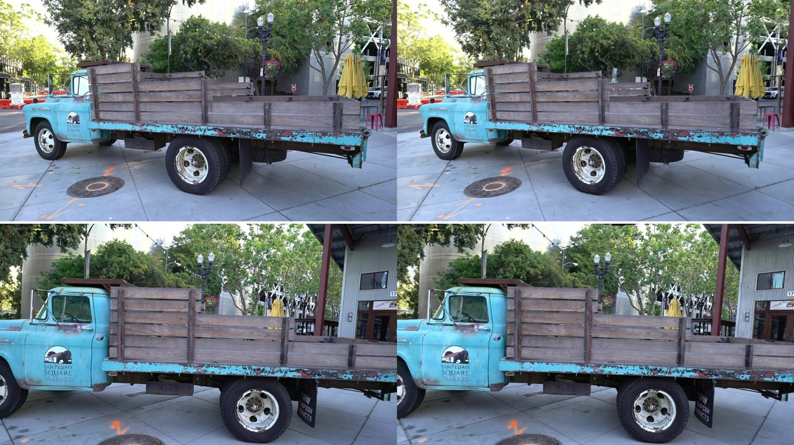
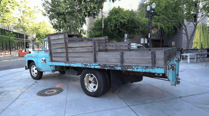

# gaussian-splat-trainer

3D Gaussian splatting (Kerbl et al., SIGGRAPH 2023), implemented from the paper: a trainer that turns a set of photos into a scene made of about two million 3D Gaussians, which can then be rendered from new viewpoints.

The GPU work runs in hand-written Metal compute kernels for Apple GPUs:
- projection of each Gaussian to the screen, with spherical-harmonics colour;
- tile-based sorting;
- alpha-compositing rasterization;
- the backward pass of all of these.

Every kernel has a plain-PyTorch twin. The tests check that values and gradients agree, to about 1e-6.

On the Tanks and Temples **Truck** scene, with the paper's train/test split, it matches the paper's quality:

| Truck, 32 held-out views | PSNR | SSIM | LPIPS |
|---|---|---|---|
| this trainer, 30k steps | **25.42** | **0.882** | **0.147** |
| 3DGS paper, 30k steps (Kerbl et al., Table 8 and 9) | 25.19 | 0.879 | 0.148 |
| this trainer, 7k steps | 23.31 | 0.840 | |
| 3DGS paper, 7k steps | 23.51 | 0.840 | 0.209 |

Training took 2 h 4 min on an Apple M4 Pro laptop (16-core GPU) and ended with 2.57 million Gaussians. For comparison, the paper reports 27 min on an RTX A6000, averaged over the Tanks and Temples scenes.



## Results



### Evaluation (`bench/evaluate.py`, `results/truck_30k.json`)

The protocol is the paper's:
- every 8th image in name order is held out (32 of 251);
- training is at the dataset's 979x546 resolution;
- renders are scored as 8-bit images.

**LPIPS is reported twice:**
- **0.147:** VGG LPIPS with [0, 1] inputs, which is how the paper's evaluation script computes it. Its `metrics.py` loads images with `to_tensor` and passes them straight to an LPIPS network that expects [-1, 1].
- **0.178:** with inputs scaled to [-1, 1], as the `lpips` package documents. Other papers' LPIPS numbers are not always comparable with the paper's for this reason.

The 7k comparison has no LPIPS for this trainer because that checkpoint was not kept.

### Where the time goes (`bench/profile.py`, `results/profile.json`)

One training step on the final 2.57M-Gaussian model, 979x546:

| stage | ms |
|---|---|
| projection + spherical harmonics, PyTorch (autograd), forward + backward | 955.7 |
| projection + spherical harmonics, **Metal kernel**, forward + backward | **46.9** |
| tile binning (4.4M tile overlaps, one stable int16 sort) | 33.1 |
| rasterize forward | 14.6 |
| rasterize forward + backward | 56.3 |
| loss, L1 + SSIM, forward + backward | 28.1 |

- **Projection.** The first version left projection to PyTorch. It took 121 ms of a 170 ms step at 226k Gaussians, because MPS runs hundreds of thousands of 3x3 matrix products slowly. As one Metal thread per Gaussian, with a hand-derived backward pass, it is 20x faster at 2.57M Gaussians.
- **Binning.** Sorting Gaussians by depth first and then doing a stable sort on int16 tile ids replaced a sort on combined int64 keys: 54 ms → 26 ms at 900k Gaussians.

### Two bugs the evaluation caught (`results/ablations.json`)

The first full run scored 19.35 dB at 7k steps, 4 dB below the paper, and got worse after each opacity reset.

**1. A rule in the paper that the reference code never applies.** The paper prunes Gaussians larger than 20 px on screen, and this trainer did. In the reference implementation the check reads `max_radii2D` right after `densification_postfix()` has set it to zero, so it never fires (`scene/gaussian_model.py`, lines 407 and 462). Applying it for real deletes the large Gaussians that cover road, sky and shadow every 100 steps:

| test PSNR, Truck | step 2,500 | step 5,000 | step 7,000 |
|---|---|---|---|
| screen-space pruning off (default, like the reference code) | 22.34 | 22.93 | 23.25 |
| screen-space pruning on (`--screen-prune`, like the paper's text) | 22.37 | 19.30 | 18.87 |

**2. Not a bug: the gradient through the alpha clamp.** Alpha is `min(0.99, opacity · G)`.
- The first kernel used the exact derivative, which is zero above the clamp. The reference CUDA code passes the gradient straight through.
- Both are implemented and both match their PyTorch twins. They gave 21.76 vs 21.84 dB at 2,000 steps, so the clamp was not the cause.
- The default now follows the reference; `--exact-clamp` selects the exact derivative.

### Memory

Peak GPU memory was 11.6 GB, including 1.4 GB of training images.

An earlier run died at 730k Gaussians with "other allocations: 23 GB". Tensor sizes change every step (the tile list) and every 100 steps (the Gaussians), and PyTorch's MPS caching allocator kept the odd-sized freed blocks. Emptying the cache after each densification step fixed it.

## Correctness

16 tests (`python -m pytest -q`, a few seconds on the M4 Pro):

- **Rasterizer.** The Metal forward and backward against a dense PyTorch rasterizer that applies the same rules: tile culling, the 1/255 skip, the 1e-4 stop and the 0.99 clamp. Images agree to 1e-6, and all four gradients (means, conics, colours, opacities) to about 1e-6 relative, in both clamp modes.
- **Projection and colour.** The Metal kernel against `project.py` plus autograd, for SH degrees 0 to 3, with culled and clamped Gaussians included. The median relative error of every gradient is about 1e-7. Flipping one sign in the quaternion gradient fails the test.
- **Binning** against a brute-force tile-by-tile list.
- **Projection** against a hand-computed pinhole case.
- **Densification:** clone, split and prune counts, and optimizer state staying row-aligned.
- **PLY** round trip.
- **End to end.** Training on a synthetic scene must recover at least 10 dB. Without an Apple GPU (CI), this runs on the PyTorch reference path.

## What is in it

```
splat/
  colmap.py          COLMAP binary reader (cameras, images, points)
  scene.py           cameras and images, train/test split (every 8th view)
  project.py         EWA projection and SH colour in PyTorch (the reference)
  project_metal.py   the same as one Metal kernel per Gaussian, forward and backward
  raster.py          tile binning, dense reference rasterizer, Metal forward/backward
  render.py          projection + rasterization, SSIM, PSNR
  gaussians.py       parameters, Adam with resizable state, densification
  train.py           training loop and evaluation
  ply.py             .ply in the reference layout (opens in common splat viewers)
  video.py           fly-through along the capture path
tests/               rasterizer, projection, binning, densification, end-to-end fit
docs/how-it-works.md the maths of every stage, both backward passes, and the bugs found
```

## Run it

```bash
pip install -r requirements.txt     # torch, numpy, pillow, scipy
# Tanks&Temples and Deep Blending scenes with COLMAP poses, as released by the 3DGS authors (650 MB)
curl -L -o tandt_db.zip https://huggingface.co/camenduru/gaussian-splatting/resolve/main/tandt_db.zip
unzip tandt_db.zip -d data
python -m splat.train --scene data/tandt/truck --out output/truck
python -m splat.video --scene data/tandt/truck --ply output/truck/point_cloud.ply --out truck.mp4
python -m pytest -q
```

The Metal kernels need an Apple GPU. Elsewhere the tests run the PyTorch reference path, which is how CI runs.

## Limits

- **No CUDA kernels yet.** The kernels are Metal only. On other machines only the dense reference path runs, which is fine for tests but far too slow for training.
- **One scene evaluated so far.** Train, Playroom and DrJohnson come in the same download.
- **Loading.** Training images are held on the GPU in float32: 1.4 GB for Truck.
- **Speed.** Rendering a trained view takes about 80 ms at 979x546, with Python in the loop. That is fine for training and evaluation, but not real time. The paper's CUDA renderer runs at 154 fps on these scenes (RTX A6000).
